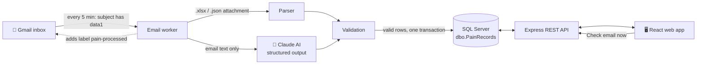
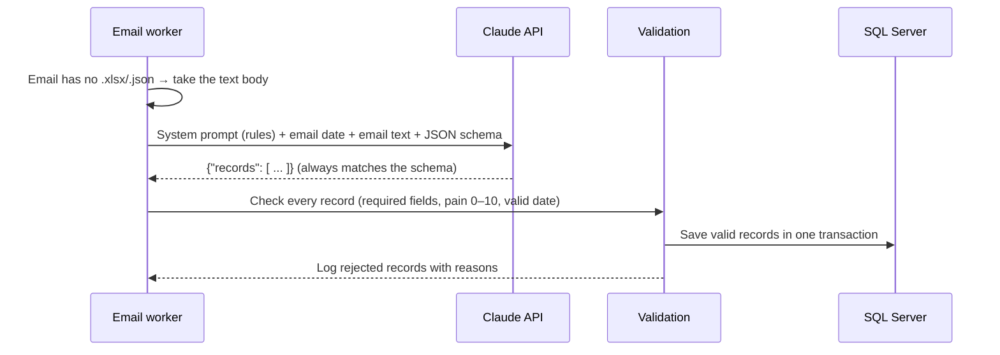

<div align="center">

# 🩺 Pain Records Automation: AI Edition

**Gmail ➜ AI extraction ➜ SQL Server ➜ Web App: pain data imported automatically from email attachments *and* from plain email text.**


</div>

> This is the AI-enhanced version of [AIAutomation_agent](https://github.com/pritpalkaur/AIAutomation_agent),
> which is the rule-based version with no LLM.

---

## 📖 Table of contents

- [What it does](#-what-it-does)
- [How it works](#-how-it-works)
- [Features](#-features)
- [How the AI extraction works](#-how-the-ai-extraction-works)
- [Technology](#-technology)
- [Quick start](#-quick-start)
- [Configuration](#%EF%B8%8F-configuration)
- [Attachment format](#-attachment-format)
- [REST API](#-rest-api)
- [Project structure](#-project-structure)
- [Troubleshooting](#-troubleshooting)

---

## 💡 What it does

1. Someone sends an email with **`data1`** in the subject. It can have an **Excel or JSON** file attached,
   or the pain report can simply be **written in the email text**.
2. The tool finds the email in **Gmail**:
   - **Attachments** are read with rule-based code.
   - **Plain text** like *"Asha from India has severe lower back pain, 8/10, since this morning"* is turned
     into structured records by **Claude AI**.
3. Every record is validated and saved to **SQL Server**.
4. The records show up in a **React web app**, where you can search, add, edit and delete them, or paste
   text into **✨ AI import** to preview what the AI extracts before saving.

---

## 🔄 How it works



---

## ✨ Features

### 🤖 AI extraction (new in this edition)
| | |
|---|---|
| ✍️ **Reads free-form text** | Emails without an attachment are read by Claude and turned into records |
| 👥 **Multiple patients** | One email can mention several patients; each becomes its own record |
| 🧠 **Understands language** | "severe" → 8, "7 out of 10" → 7, "this morning" → the actual date and time |
| 📐 **Structured outputs** | The AI must answer in an exact JSON schema, so its output is always machine-readable |
| ✅ **Same validation** | AI results go through the same checks as Excel rows; nothing unchecked reaches the database |
| 👀 **Human review** | **✨ AI import** in the web app shows a preview with ✅/⚠️ per row before anything is saved |
| 🛡️ **Safety fallback** | If the model declines a request, the API retries automatically on a fallback model |
| 🔌 **Optional** | No API key means no AI: the app works exactly like the rule-based version |

### 📧 Automatic email import
| | |
|---|---|
| 🔍 **Smart search** | Finds emails whose subject contains `data1` and that have an attachment |
| 📄 **Excel & JSON** | Reads `.xlsx` and `.json` attachments |
| 🏷️ **No duplicates** | Adds the Gmail label `pain-processed` after import, so an email is never imported twice |
| 🛡️ **Safe saving** | Valid rows from one email are saved together in a single transaction |
| ✅ **Validation** | Bad rows are skipped and logged with the reason (e.g. *pain_level must be 0–10*) |
| 🔁 **Auto retry** | If an import fails (e.g. database offline), it is retried on the next check |
| 🔤 **Flexible headers** | `Patient Name`, `patient-name` and `patient_name` all work |

### 🔌 REST API
- Full **CRUD**: create, read, update and delete records
- **Search** by patient name, country or pain location, with **paging**
- **Soft delete**: rows are kept with `is_deleted = 1`, not removed
- Clear JSON error messages for invalid input

### 🖥️ Web application
- Records table with color-coded pain levels: 🟢 low (0–3) · 🟡 medium (4–6) · 🔴 high (7–10)
- Search box and paging
- **Add / Edit** form and **Delete** with confirmation
- **Check email now** button with an import summary

---

## 🤖 How the AI extraction works

The code is in [`server/src/aiExtractor.js`](server/src/aiExtractor.js). One email is handled in five steps:



**1. Prompt.** A *system prompt* tells the model what to do and how to convert values:
"severe" ≈ 8, "UK" → "United Kingdom", and "this morning" resolved against the email's sent date.
The email date is sent with the text, so relative times become real timestamps.

**2. Structured outputs.** The request includes a **JSON Schema** (`output_config.format`). The API
guarantees that the answer is valid JSON in exactly that shape: a `records` array whose items have
`patient_name`, `country`, `pain_level`, `pain_location`, `occurred_at` and `notes`. That's why the
code can safely `JSON.parse` the answer without guessing.

**3. Validation, as with Excel.** A schema guarantees the *shape*, not that the *values* make sense.
Every AI record therefore goes through the same `validateRecord()` as Excel rows: a pain level of 15,
an empty country or an unreadable date is rejected and logged.

**4. Protection against prompt injection.** Email text comes from outside senders and could contain
instructions like *"ignore your rules"*. The system prompt says to treat the email only as data, the
text is wrapped in `<email_body>` tags, and the output can only be records in the fixed schema. The
model can't run commands or touch the database; only validated rows are saved.

**5. Reliability and cost.**
- `effort: "low"`: extraction is a simple task, so the model answers quickly and uses fewer tokens.
- `fallbacks: "default"`: if the model declines a request for safety reasons, the API retries on a
  fallback model automatically. A final refusal is reported as an error, not saved.
- Emails longer than `AI_MAX_INPUT_CHARS` are rejected rather than cut off, so no data is silently lost.
- An email that fails is not labelled, so it is retried on the next check.

**Example.** This email text:

> Patient Asha Verma from India called this morning. She has severe pain in her lower back, about
> 8 out of 10, since lifting a heavy box. Taking ibuprofen. Also, Liam Carter (Canada) reported mild
> wrist pain yesterday at 3pm.

becomes:

```json
{
  "records": [
    { "patient_name": "Asha Verma", "country": "India", "pain_level": 8,
      "pain_location": "lower back", "occurred_at": "2026-10-01T09:00:00",
      "notes": "Started after lifting a heavy box; taking ibuprofen" },
    { "patient_name": "Liam Carter", "country": "Canada", "pain_level": 2,
      "pain_location": "wrist", "occurred_at": "2026-09-30T15:00:00", "notes": null }
  ]
}
```

*(The exact wording of `notes` and the time chosen for "this morning" can vary between runs.)*

> ⚠️ **Privacy:** with AI on, email text containing patient information is sent to the Anthropic API.
> Check that this is allowed for your data (for example under HIPAA or GDPR rules) before using it with
> real patients. Without an API key, nothing leaves your computer except the Gmail connection.

---

## 🧰 Technology

| Layer | Technology | Purpose |
|---|---|---|
| Runtime | **Node.js 22** | One language (JavaScript) for the whole project |
| API | **Express 5** | REST endpoints and error handling |
| Database | **Microsoft SQL Server** · `mssql` | Stores records; parameterized queries prevent SQL injection |
| Email | **Gmail IMAP** · `imapflow` | Gmail search and labels, login with an App Password |
| Excel | `exceljs` | Reads `.xlsx` files, including dates and formulas |
| Config | `dotenv` | Loads settings and passwords from a local, git-ignored `.env` |
| AI | **Claude Opus 5.5** · `@anthropic-ai/sdk` | Turns free-form email text into records using structured outputs |
| Frontend | **React 19** | Interactive user interface |
| Build tool | **Vite** | Fast dev server that forwards `/api` calls to the API |

---

## 🚀 Quick start

### Prerequisites
- [Node.js](https://nodejs.org) 20 or newer
- SQL Server with the `dbo.PainRecords` table (definition under [Attachment format](#-attachment-format)),
  **SQL Server authentication** enabled and **TCP/IP** turned on
- A Gmail account with **2-Step Verification** and **IMAP** enabled

### 1️⃣ Get a Gmail App Password
1. Open **<https://myaccount.google.com/apppasswords>**. Make sure the account in the top-right corner is the one you will read.
2. Create an App Password and copy the **16 letters**.
3. In Gmail: ⚙️ → **See all settings** → **Forwarding and POP/IMAP** → **Enable IMAP** → **Save**.

### 1️⃣➕ Get an Anthropic API key (for AI extraction)
1. Sign in at **<https://console.anthropic.com>** and add billing credit.
2. Go to **Settings → API keys → Create key** and copy it (it starts with `sk-ant-`).
3. Put it in `server/.env` as `ANTHROPIC_API_KEY=sk-ant-...`. Never commit this key.

### 2️⃣ Start the server
```powershell
cd server
copy .env.example .env     # fill in your database and Gmail settings
npm install
npm run check-gmail        # ✅ should print "login: OK"
npm run dev                # API runs on http://localhost:4000
```

### 3️⃣ Start the web app
Open a second terminal:
```powershell
cd client
npm install
npm run dev                # open http://localhost:5173
```

### 4️⃣ Try it out
1. Send an email to your Gmail with the subject **`data1 test`**.
2. Attach [`server/samples/data1-sample.xlsx`](server/samples/data1-sample.xlsx) or [`data1-sample.json`](server/samples/data1-sample.json).
3. In the web app, click **Check email now**. The new rows appear in the table. 🎉

**Try the AI:**
- **In the web app:** click **✨ AI import** → **Use sample text** → **Extract with AI** → review → **Save**.
- **By email:** send an email with subject `data1 note`, **no attachment**, and a sentence such as
  *"Maria Lopez from Spain has moderate knee pain since yesterday evening."* Then click **Check email now**.

---

## ⚙️ Configuration

All settings live in `server/.env`. Copy the template from [`server/.env.example`](server/.env.example).

| Setting | Example | Description |
|---|---|---|
| `PORT` | `4000` | API port |
| `DB_SERVER` | `localhost` | SQL Server host name |
| `DB_NAME` | `PainDb` | Database that contains `dbo.PainRecords` |
| `DB_USER` / `DB_PASSWORD` | | SQL Server login |
| `DB_PORT` **or** `DB_INSTANCE` | `1433` / `SQLEXPRESS` | Use one, not both |
| `DB_ENCRYPT` / `DB_TRUST_CERT` | `false` / `true` | TLS options (defaults suit a local server) |
| `GMAIL_USER` | `you@gmail.com` | Gmail address to read |
| `GMAIL_APP_PASSWORD` | `abcd efgh ijkl mnop` | 16-letter App Password (spaces are fine) |
| `ANTHROPIC_API_KEY` | `sk-ant-...` | Turns on AI extraction ([get a key](https://console.anthropic.com/settings/keys)); empty = AI off |
| `AI_MODEL` | `claude-opus-5-5` | Claude model used for extraction |
| `AI_EXTRACTION` | `off` | Keeps the key but turns AI off |
| `AI_MAX_INPUT_CHARS` | `50000` | Longer emails are rejected instead of sent |
| `GMAIL_MAILBOX` | `INBOX` | Folder to search |
| `EMAIL_SUBJECT_KEYWORD` | `data1` | Subject text to look for |
| `EMAIL_PROCESSED_LABEL` | `pain-processed` | Label added after import |
| `EMAIL_POLL_MINUTES` | `5` | How often to check Gmail (`0` = off) |

> 🔒 `.env` is listed in `.gitignore`, so your passwords are never committed.

---

## 📄 Attachment format

| Column | Required | Rules |
|---|:---:|---|
| `patient_name` | ✅ | Text, up to 200 characters |
| `country` | ✅ | Text, up to 100 characters |
| `pain_level` | ✅ | Whole number from **0 to 10** |
| `pain_location` | ✅ | Text, up to 200 characters |
| `occurred_at` | ✅ | Date and time |
| `notes` | | Text, up to 2000 characters |

<details>
<summary><b>📊 Excel example</b></summary>

The first sheet is used, and **row 1 must contain the column names**:

| patient_name | country | pain_level | pain_location | occurred_at | notes |
|---|---|---|---|---|---|
| Email Test One | India | 6 | Lower back | 2026-09-29 09:15 | Imported from Excel |
| Email Test Two | Canada | 2 | Wrist | 2026-09-30 14:00 | |

</details>

<details>
<summary><b>🧾 JSON example</b></summary>

An array of records, or `{ "records": [ ... ] }`:

```json
[
  {
    "patient_name": "Asha",
    "country": "India",
    "pain_level": 7,
    "pain_location": "Lower back",
    "occurred_at": "2026-09-01T10:00:00",
    "notes": "After lifting"
  }
]
```

</details>

<details>
<summary><b>🗄️ Table definition</b></summary>

```sql
CREATE TABLE [dbo].[PainRecords](
    [id]            INT IDENTITY(1,1) NOT NULL PRIMARY KEY,
    [patient_name]  NVARCHAR(200)  NOT NULL,
    [country]       NVARCHAR(100)  NOT NULL,
    [pain_level]    TINYINT        NOT NULL,
    [pain_location] NVARCHAR(200)  NOT NULL,
    [occurred_at]   DATETIME2(3)   NOT NULL,
    [notes]         NVARCHAR(2000) NULL,
    [created_at]    DATETIME2(3)   NOT NULL,
    [updated_at]    DATETIME2(3)   NULL,
    [is_deleted]    BIT            NOT NULL
);
```

</details>

---

## 🔌 REST API

Base URL: `http://localhost:4000`

| Method | Endpoint | Description |
|---|---|---|
|  | `/api/pain-records?search=&page=1&pageSize=20` | List records, newest first |
|  | `/api/pain-records/:id` | Get one record |
|  | `/api/pain-records` | Create a record |
|  | `/api/pain-records/:id` | Update a record |
|  | `/api/pain-records/:id` | Soft-delete a record |
|  | `/api/email/fetch` | Check Gmail now and return a summary |
|  | `/api/ai/extract` | Body `{ "text": "..." }`: AI extracts and validates records, **without saving** |
|  | `/api/ai/status` | Whether AI extraction is on, and which model |
|  | `/api/health` | Health check |

<details>
<summary><b>Example requests and responses</b></summary>

**Create a record**
```powershell
Invoke-RestMethod -Method Post http://localhost:4000/api/pain-records `
  -ContentType 'application/json' `
  -Body '{"patient_name":"Asha","country":"India","pain_level":7,"pain_location":"Lower back","occurred_at":"2026-09-01T10:00:00Z"}'
```

**List response**
```json
{
  "total": 1,
  "page": 1,
  "pageSize": 20,
  "items": [
    { "id": 1, "patient_name": "Asha", "country": "India", "pain_level": 7,
      "pain_location": "Lower back", "occurred_at": "2026-09-01T10:00:00.000Z",
      "notes": null, "created_at": "2026-09-01T10:05:00.000Z", "updated_at": null }
  ]
}
```

**Validation error (400)**
```json
{ "errors": ["country is required", "pain_level must be a whole number from 0 to 10"] }
```

**Email check summary**
```json
{ "emails": 1, "attachments": 2, "inserted": 3, "rejectedRows": [], "failedEmails": [] }
```

</details>

---

## 📁 Project structure

```
AIAutomation_agent/
├── server/                     Node.js API + Gmail worker
│   ├── src/
│   │   ├── index.js            Starts the API and the scheduled email check
│   │   ├── app.js              REST API routes
│   │   ├── emailWorker.js      Gmail search, attachment download, import
│   │   ├── parseAttachment.js  Excel / JSON reader
│   │   ├── painRecords.js      Validation and SQL queries
│   │   ├── db.js               SQL Server connection pool
│   │   ├── config.js           Settings from .env
│   │   ├── aiExtractor.js      🤖 Claude prompt, JSON schema and response handling
│   │   └── checkGmail.js       Gmail login test (npm run check-gmail)
│   ├── samples/                Example attachments for testing
│   └── .env.example            Settings template
└── client/                     React web app
    └── src/
        ├── App.jsx             Records table, search, paging
        ├── AiImport.jsx        ✨ Paste text → AI preview → save
        ├── RecordForm.jsx      Add / edit form
        ├── api.js              REST API calls
        └── styles.css          Styling
```

### npm scripts

| Folder | Command | What it does |
|---|---|---|
| `server` | `npm run dev` | Start the API with auto-restart on code changes |
| `server` | `npm start` | Start the API |
| `server` | `npm run check-gmail` | Test the Gmail login and list emails waiting to import |
| `client` | `npm run dev` | Start the web app |
| `client` | `npm run build` | Build the web app for production |

---

## 🛠️ Troubleshooting

| Problem | Fix |
|---|---|
| `Invalid credentials` from Gmail | Use a **16-letter App Password**, not your normal password. Check that `GMAIL_USER` **exactly** matches the account that created it. Changing your Google password cancels old App Passwords. |
| App Passwords page is not available | Turn on **2-Step Verification** first. |
| `emails waiting to import: 0` | Check the subject contains `data1`, the file is **attached** (not a link), and the email is not already labelled `pain-processed`. |
| No **✨ AI import** button | `ANTHROPIC_API_KEY` is missing in `server/.env`. Restart the server after adding it. |
| `401 authentication_error` from AI | The API key is wrong or was revoked. Create a new one in the Anthropic Console. |
| AI rows marked ⚠️ | The text didn't contain a required field (often the country). Fix the source text, or add the record manually. |
| `Login failed for user ...` | Check `DB_USER` / `DB_PASSWORD`, and that **SQL Server authentication** is enabled. |
| Cannot connect to SQL Server | Turn on **TCP/IP** in SQL Server Configuration Manager. For a named instance, set `DB_INSTANCE` and start the **SQL Server Browser** service. |
| `Invalid object name 'dbo.PainRecords'` | `DB_NAME` points to the wrong database. |
| Rows skipped during import | The server console lists each rejected row and the reason. |
| Web app shows a request error | Make sure the server (`npm run dev` in `server`) is running on port 4000. |
